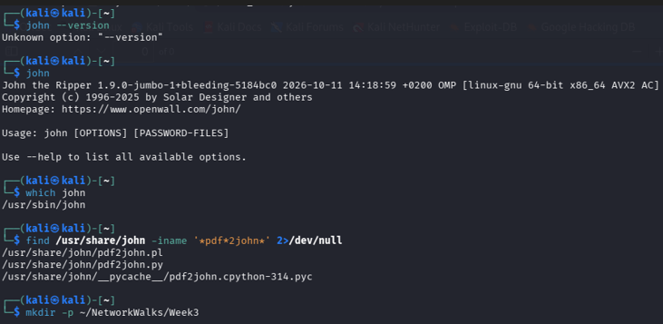
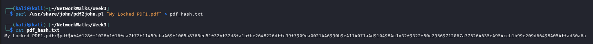
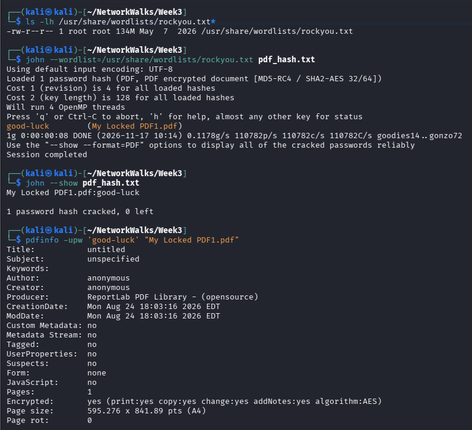
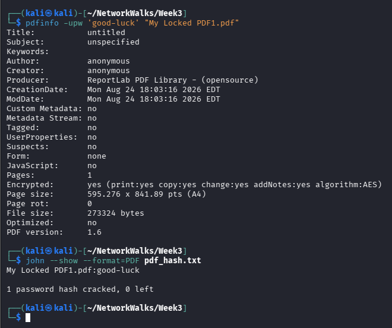
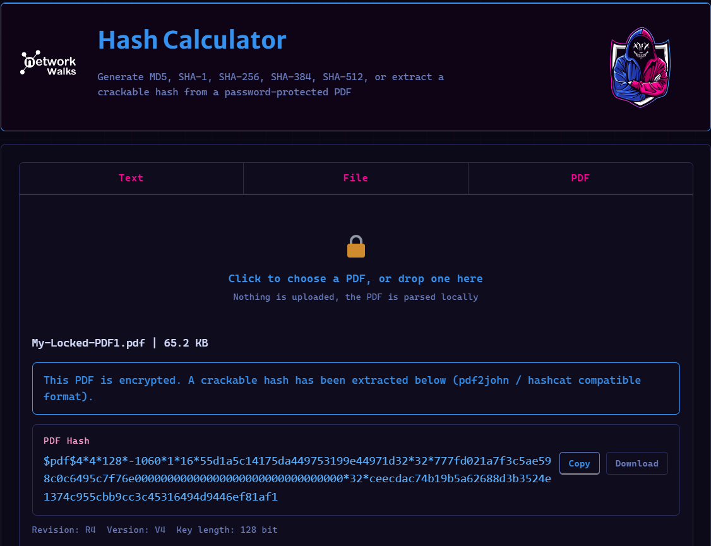
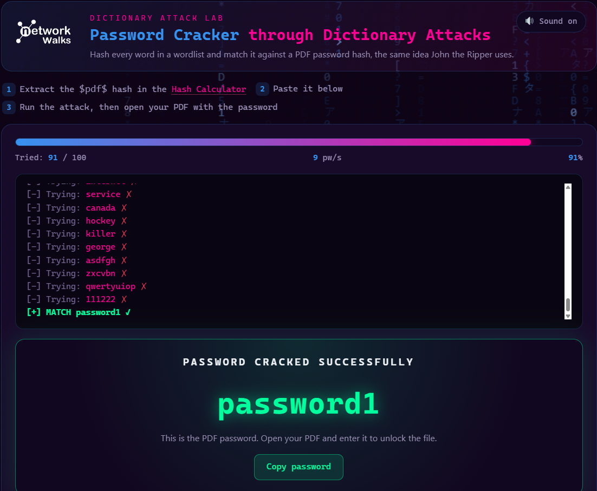

# NetworkWalks Cybersecurity Internship – Week 3
## Password Cracking

**Intern:** Abdul Ahad Abbasi  
**Intern Code:** B084  
**Domain:** Cybersecurity & Ethical Hacking  
**Organization:** NetworkWalks IT Solutions & Training  
**Week:** 03

---

## Project Overview

This repository documents the Week 3 practical assignments focused on password cracking, hash analysis, and password recovery.

The tasks involve using John the Ripper and NetworkWalks-provided tools in a controlled cybersecurity training environment.

## Practical Assignments

### PM1 – Password Cracking Using John the Ripper

**Tool:** John the Ripper (JTR)  
**Platform:** Kali Linux  
**Technique:** Dictionary-based password cracking

**Tasks performed:**
- Installed and verified John the Ripper.
- Extracted password hashes from the provided sample.
- Performed a dictionary attack.
- Successfully recovered the password.

**Recovered password:** `good-luck`

#### Screenshots

**01 – John the Ripper Installation**



**02 – Hash Extraction**



**03 – Dictionary Attack**



**04 – Password Recovered**



---

### PM2 – NetworkWalks Password Cracking Tools

**Tools:** NetworkWalks Hash Calculator and Password Cracker

**Tasks performed:**
- Used the Hash Calculator to analyze password hashes.
- Tested password hashes using the Password Cracker.
- Successfully recovered the sample password.
- Retrieved the first flag as part of the practical exercise.

**Recovered password:** `password1`

#### Screenshots

**01 – Hash Calculator**



**02 – Password Cracker**



**03 – First Flag**


---

## Tools & Technologies

- Kali Linux
- John the Ripper
- NetworkWalks Hash Calculator
- NetworkWalks Password Cracker
- Linux Command Line
- Dictionary Attack Technique

## Learning Outcomes

- Understanding password hashes and password cracking.
- Installing and using John the Ripper.
- Extracting password hashes for analysis.
- Performing dictionary-based password attacks.
- Understanding hash calculation and password verification.
- Practicing password security assessment in a controlled environment.

## Repository Structure

```text
.
├── README.md
├── W3-PM1-JTR/
│   └── Screenshots/
│       ├── 01-John-Installation.png
│       ├── 02-Hash-Extraction.png
│       ├── 03-Dictionary-Attack.png
│       └── 04-Password-Recovered.png
└── W3-PM2-NW-TOOLS/
    └── Screenshots/
        ├── 01-Hash-Calculator.png
        ├── 02-Password-Cracker.png
        └── 03-First-Flag.png

```

---

## Disclaimer

All activities documented in this repository were performed as part of authorized cybersecurity training exercises. Password cracking techniques should only be used on systems, files, and hashes for which explicit permission has been granted.

---

**NetworkWalks Cybersecurity Internship – Week 3**
